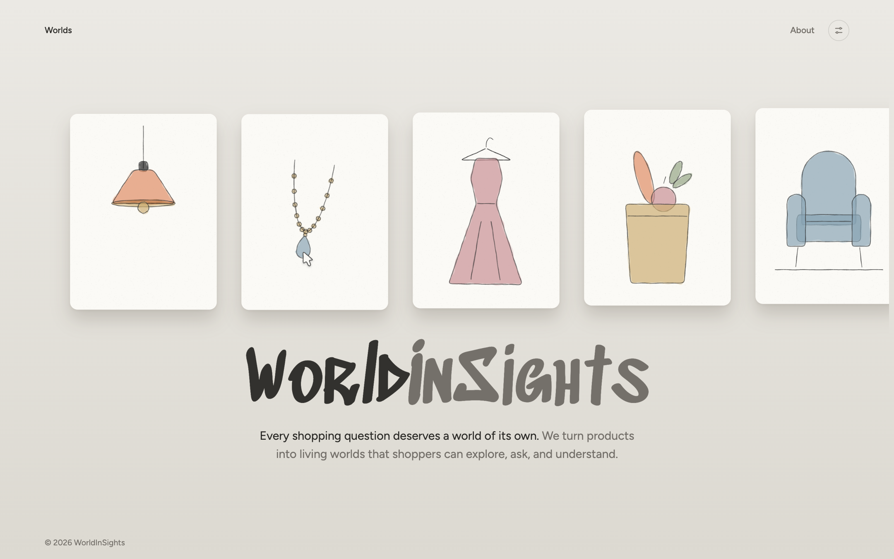
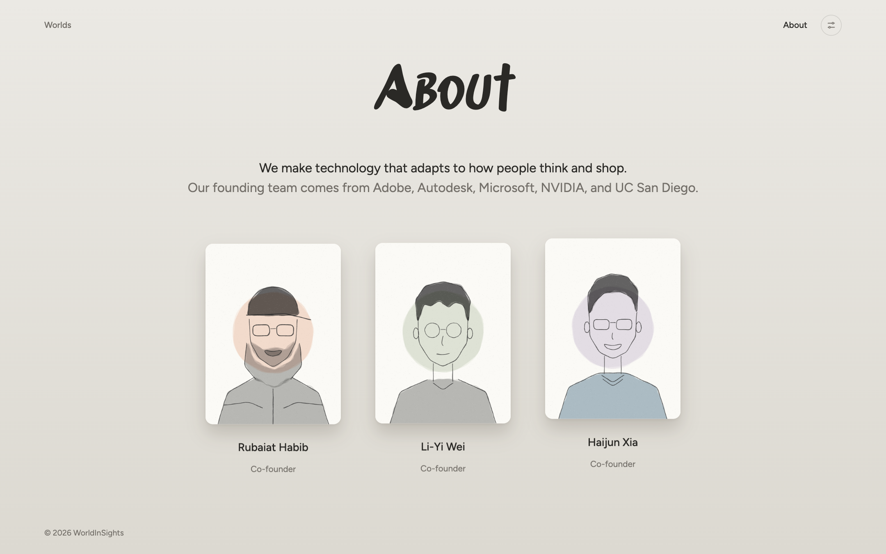

# WorldInSights company website

A two-page site for investors and friends: a homepage and an About page. Everything (HTML, CSS, JavaScript and the hand-drawn art) lives in one file, `index.html`. There is no build step and no dependencies beyond Google Fonts.

| Homepage | About |
| --- | --- |
|  |  |

## View it

Open `index.html` in a browser. The About page is at `index.html#about`.

To serve it locally instead, for example to test on a phone on the same network:

```bash
cd company-website && python3 -m http.server 8000
```

Then open `http://localhost:8000` (or your computer's IP address and port 8000 from the phone).

## What's on the page

- **Homepage:** a row of six product windows (lamp, necklace, dress, groceries, armchair, serum), the WorldInSights name, and the tagline.
  - On load, the letters write themselves in and every window gives a small hop.
  - A hand-drawn cursor then demonstrates one window at a time, about 2.7 s each. It explodes, recolors, rotates or moves the product, and the window nearest the visitor's pointer goes next.
  - Hovering a window lifts the product out into a faint sketch of where it lives, with a little settle physics. The other windows move aside, and the tagline is replaced by that product's shopper question.
- **About:** a one-line statement, the team's background, and pencil portraits of the three co-founders.
- **Settings** (the slider icon, top right): title font, two color themes, two drawing styles, title position, and text effects. Choices are saved in the visitor's browser.

## Common edits

All of these are in `index.html`.

| To change | Look for |
| --- | --- |
| The company name | The `WORDS` array (`World` / `In` / `Sights`) and the `<title>`, `aria-label`, footer and font-preview text, all of which say `WorldInSights` |
| Hide the name while it's being decided | Set `SHOW_TITLE = false`. The tagline stays. |
| Tagline | `<p id="line">` |
| About text | `<p class="lead">` inside `<main id="about">` |
| Founder names or portraits | The `FOUNDERS` array. Each portrait is a list of simple shapes in a 0–1 box. |
| Product questions shown on hover | The `q` field of each entry in `PRODUCTS` |
| Product drawings and their settings | The `shapes` and `env` lists in `PRODUCTS` |
| Cursor demos | `DEMOS`: each product has two or three short `moves` |
| Default font, theme or effects | `DEFAULTS` near the top of the script |

## Screen sizes

The layout was checked at phone (375 × 812 and 812 × 375), tablet (768 × 1024 and 1024 × 768), laptop (1280 × 800) and large monitor (1920 × 1080) sizes:

- Windows and the name scale with both the width and the height of the screen.
- The row of windows is centered when it fits and scrolls sideways when it doesn't.
- The founders stay in a row of three.

Touch devices don't get the hover lift-out; the demos still play on their own.

## Accessibility

- Every window and portrait has an accessible name.
- The hover question is announced with `aria-live`.
- The settings panel works with the keyboard and closes with Esc.
- With "reduce motion" turned on in the operating system, the demos, drift and ink-in animation are switched off.
